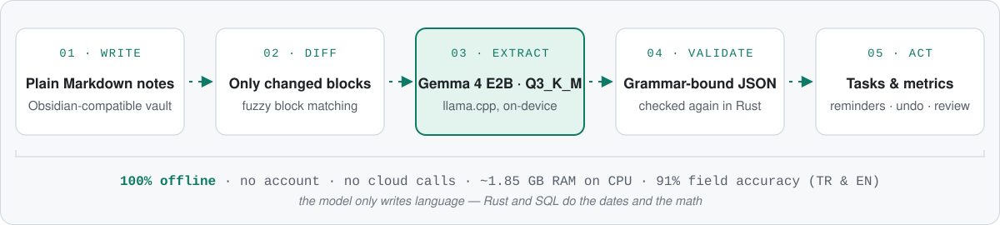

  🌐  

<picture>
  <source media="(prefers-color-scheme: dark)" srcset="assets/header-dark.svg">
  
</picture>

  
  
  
  

## Hakkımda

Gümüşhane Üniversitesi'nde **Yazılım Mühendisliği** 3. sınıf öğrencisiyim ve hedefim **yapay zekâ / makine öğrenmesi mühendisliği**.
Beni en çok *verinin bulunduğu yerde* çalışan yapay zekâ heyecanlandırıyor: bilgisayarında, küçük bir cihazda, bir İHA'da. Başkasının bulutunda değil.

- 🔭 **Geliştiriyorum:** [PLA](https://github.com/AyberkCerit/personal_life_assistant), yerel bir dil modeliyle çalışan çevrimdışı kişisel asistan (Rust · Tauri · llama.cpp)
- 🏛️ **2026 yazı:** **Bilim A.Ş.**'de (Konya Büyükşehir Belediyesi teknoloji birimi) yazılım geliştirme stajyeri; Laravel + Docker üzerinde saha denetim ve görev yönetim sistemi geliştirdim
- 🌱 **Öğreniyorum:** otonom İHA'lar için pekiştirmeli öğrenme, görüntü işleme, işletim sistemleri
- 🤝 **Açığım:** yapay zekâ / ML stajlarına ve cihaz üzerinde çalışan yapay zekâ sohbetlerine

## Öne çıkan proje: PLA, bilgisayarından çıkmayan kişisel asistan

Notlar, görevler, hatırlatıcılar ve sağlık ölçümleri tek bir masaüstü uygulamasında, **tamamen çevrimdışı**.
Yapay zekâ yandan eklenmiş bir sohbet botu değil. Arka planda çalışıyor: yazdıklarını okuyup sessizce görev, hatırlatıcı ve ölçüme çeviriyor. Sorduğunda kendi notlarından cevap veriyor.

<picture>
  <source media="(prefers-color-scheme: dark)" srcset="assets/pla-pipeline-dark.svg">
  
</picture>

<table>
  <tr>
    <td width="27%" valign="top">🧪 <b>Model ölçümle seçildi</b></td>
    <td>Dört küçük açık modeli Türkçe ve İngilizce notlarla denedim. Gemma 4 E2B kazandı; Q3_K_M niceleme ve düşük bellek ayarlarıyla <b>~1,85 GB RAM</b> kullanıyor, ayrı test setinde <b>%91 alan doğruluğu / %94 kesinlik</b> alıyor.</td>
  </tr>
  <tr>
    <td width="27%" valign="top">🔒 <b>Tasarım gereği yerel</b></td>
    <td><code>llama-server</code>, <code>127.0.0.1</code> adresine bağlı yerel bir yan süreç olarak çalışır ve uygulamayla birlikte kapanır; hesap yok, bulut çağrısı yok. Notlar düz <code>.md</code> dosyası olarak kalır, kasa Obsidian'da da açılır.</td>
  </tr>
  <tr>
    <td width="27%" valign="top">🧠 <b>Bellek ve soru-cevap</b></td>
    <td>EmbeddingGemma-300M ile anlamsal arama, araç çağıran bir asistan paneli (not arama, görev ekleme, …), günlük özetler ve haftalık rapor.</td>
  </tr>
  <tr>
    <td width="27%" valign="top">🛠️ <b>Mühendislikle yapıldı</b></td>
    <td>Önce şartname: ISO 29148 tarzı SRS'te 267 EARS gereksinimi. Rust çekirdek (<code>pla-core</code>) + Tauri 2 / Svelte 5 arayüz, FTS5'li SQLite, ~490 otomatik test, Windows kurulum dosyası.</td>
  </tr>
</table>

  
  
  
  
  
  
  
  

## Diğer projeler

<table>
  <tr>
    <td width="50%" valign="top">
      <h3><a href="https://github.com/AyberkCerit/smart-field-audit-system">Smart Field Audit System</a></h3>
      
Belediye saha ekipleri için denetim ve görev yönetimi; stajım sırasında geliştirdim. Yönetici / müdür / saha rolleri, haritalı denetim noktaları, fotoğraflı kanıt, tam etkinlik günlüğü, Excel / PDF / QR raporları.

      
<code>Laravel 12</code> <code>Docker</code> <code>MySQL</code> <code>Redis</code> <code>MinIO</code> <code>Leaflet</code>

    </td>
    <td width="50%" valign="top">
      <h3><a href="https://github.com/AyberkCerit/cogni-ticket">CogniTicket</a></h3>
      
Her talebi sıralı bir arka plan işinde bir LLM'in (Groq üzerinden Llama 3) önceliklendirip analiz ettiği destek talebi sistemi. Çatısız, düz JavaScript ile SPA benzeri arayüz.

      
<code>Laravel 12</code> <code>Groq API</code> <code>Queues</code> <code>Tailwind</code> <code>MySQL</code>

    </td>
  </tr>
  <tr>
    <td width="50%" valign="top">
      <h3><a href="https://github.com/AyberkCerit/cms-app_back-end_database">CMS &amp; Blog Platform</a></h3>
      
Rol tabanlı erişimli içerik yönetimi; eager loading ile N+1 sorguları giderildi, sık sorgulanan sütunlar indekslendi, menüler önbelleğe alındı, içerik Türkçe / İngilizce.

      
<code>Laravel 13</code> <code>PHP 8.4</code> <code>Spatie Permission</code> <code>MySQL</code> <code>Vite</code>

    </td>
    <td width="50%" valign="top">
      <h3><a href="https://ayberkcerit.github.io/Portfolio_Web/">Portfolio</a></h3>
      
Kişisel sitem: yeteneklerimi, projelerimi ve CV'mi gösteren, iki dilli, duyarlı tek sayfa; GitHub Pages'te yayında.

      
<code>HTML</code> <code>CSS</code> <code>JavaScript</code>

    </td>
  </tr>
</table>

## Araç kutusu

**Diller** 

**Masaüstü ve web** 

**Veri, altyapı ve araçlar** 

**AI / ML** 

🎓 [freeCodeCamp Python sertifikası](https://www.freecodecamp.org/certification/fcc-8f89b51a-2986-4298-b835-168ac71e984c/python-v9)

Yerel öncelikli, ölçülmüş, belgelenmiş. Uğradığın için teşekkürler.

